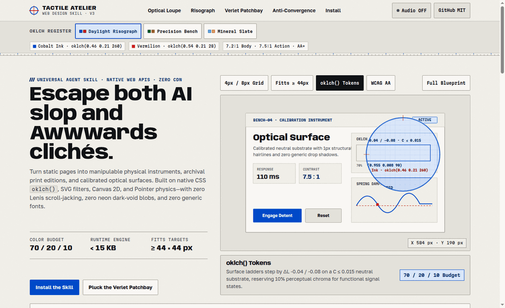
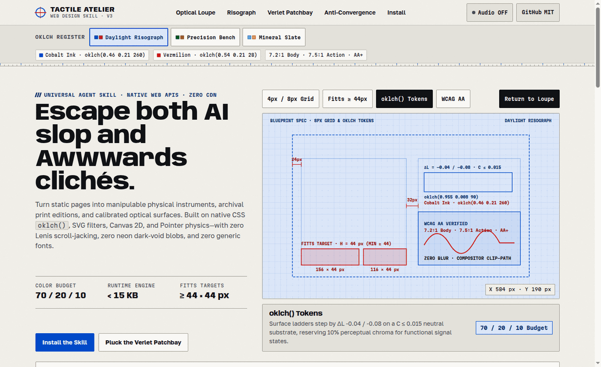
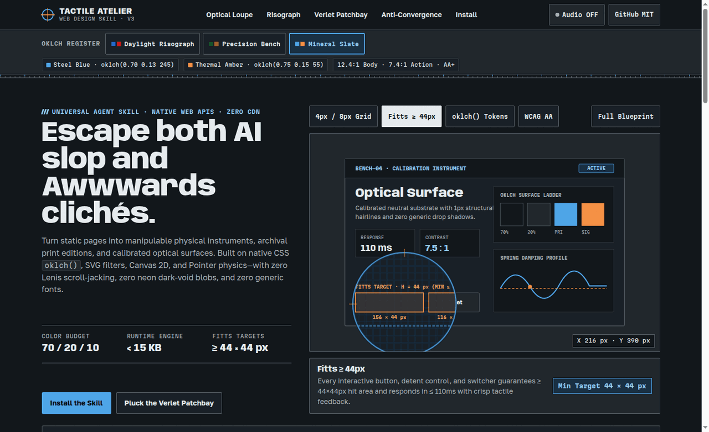

# tactile-atelier-web

**Escape both generic AI slop and Awwwards monoculture.**  
A universal Agent Skill (`SKILL.md` + reference guides) for building tactile, avant-garde, ultra-lightweight websites that feel like **manipulable physical instruments, archival risograph editions, and calibrated optical surfaces**—powered strictly by native Web APIs.

[](LICENSE)
[](docs/)
[](https://grayhawk225-pixel.github.io/atelier-web-skill/)

> **Live Interactive Showcase:** [https://grayhawk225-pixel.github.io/atelier-web-skill/](https://grayhawk225-pixel.github.io/atelier-web-skill/)  
> Built 100% with the skill's own rules: self-hosted variable `.woff2` fonts (`Anybody`, `Golos Text`, `Martian Mono`), perceptual `oklch()` registers, optical X-Ray loupe, spring-physics risograph plates, and a pluckable Verlet 2D patchbay.

---

## Visual Preview

### Daylight Risograph (`oklch()` Cobalt Ink + Signal Vermilion)


### Optical X-Ray Blueprint Mode & Mineral Slate Register
| Full Blueprint Specification (`4px/8px` Grid & `oklch()` Tokens) | Mineral Slate Register (Matte Basalt — Zero Neon Void) |
|---|---|
|  |  |

---

## Why This Skill Exists

Most frontend design prompts converge into two tired templates: purple-glow SaaS cards (**AI Slop**) or `#0B0B0B` Lenis + GSAP scroll-jacked slide decks (**Awwwards Monoculture**). `tactile-atelier-web` enforces an explicit anti-convergence protocol:

| Design & Engineering Criterion | Generic AI Slop | Awwwards Monoculture | `tactile-atelier-web` |
|---|---|---|---|
| 70 / 20 / 10 perceptual `oklch()` budget (`C ≤ 0.015` substrate) | — | — | ✓ |
| Self-hosted atypical 3-voice typography (zero Inter / Space Grotesk / CDN) | — | — | ✓ |
| Un-hijacked native scroll (zero Lenis / GSAP pin-scrubbing) | ✓ | — | ✓ |
| Real direct-manipulation instrument (loupe, springs, Verlet, detents) | — | — | ✓ |
| Custom `< 15 KB` vanilla engine (zero Three.js / bundler lock-in) | — | — | ✓ |
| Full keyboard parity, Fitts `≥ 44px`, WCAG AA, & first-class reduced motion | — | — | ✓ |

---

## The Four Pillars

1. **Non-Convergent Materiality**  
   Commit to daylight risograph overprints (`mix-blend-mode: multiply`), brushed anodized precision benches, or mineral slate substrates with procedural SVG `<feTurbulence>` paper grain—explicitly banning neon dark voids, glassmorphism blobs, and `01 / 02 / 03` decorative eyebrows.
2. **Calibrated Motion Regimes**  
   Replace viscous `power4.out` lerp everywhere with horological mechanical detents (`80–160ms`), real damped 2D spring/Verlet physics that sleep at rest, and compositor-thread `@view-transition { navigation: auto; }`.
3. **Signature Instrumental Agency**  
   Turn visitors from passive scrollers into operators using native Web APIs (`clip-path` optical loupes, misregistered print plates, pluckable Verlet cords driving variable font axes, and strictly opt-in WebAudio).
4. **Perceptual `oklch()` Semiotics & 3-Voice Typography**  
   Derive every surface step (`ΔL = -0.04 / -0.08`), hover/pressed state, and soft tint (`L 0.92 C 0.035`) mathematically in `oklch()` for WCAG AA contrast, paired with self-hosted `.woff2` Display, Body, and Tabular Telemetry voices.

---

## Installation

### Universal CLI (`skills.sh` compatible)
```bash
npx skills add grayhawk225-pixel/atelier-web-skill
```

### Claude Code (`~/.claude/skills/`)
```bash
git clone --depth 1 https://github.com/grayhawk225-pixel/atelier-web-skill.git /tmp/taw \
  && mkdir -p ~/.claude/skills \
  && cp -r /tmp/taw/skills/tactile-atelier-web ~/.claude/skills/ \
  && rm -rf /tmp/taw
```

### Cursor (`.cursor/skills/`)
```bash
git clone --depth 1 https://github.com/grayhawk225-pixel/atelier-web-skill.git /tmp/taw \
  && mkdir -p .cursor/skills \
  && cp -r /tmp/taw/skills/tactile-atelier-web .cursor/skills/ \
  && rm -rf /tmp/taw
```

### Codex / Gemini CLI / Antigravity (`~/.agents/skills/`)
```bash
git clone --depth 1 https://github.com/grayhawk225-pixel/atelier-web-skill.git /tmp/taw \
  && mkdir -p ~/.agents/skills \
  && cp -r /tmp/taw/skills/tactile-atelier-web ~/.agents/skills/ \
  && rm -rf /tmp/taw
```

### GitHub Copilot (`.github/skills/`)
```bash
git clone --depth 1 https://github.com/grayhawk225-pixel/atelier-web-skill.git /tmp/taw \
  && mkdir -p .github/skills \
  && cp -r /tmp/taw/skills/tactile-atelier-web .github/skills/ \
  && rm -rf /tmp/taw
```

### ChatGPT / Claude Web (Project Knowledge)
Download `skills/tactile-atelier-web/` and attach all four files to your Project Knowledge or Custom GPT instructions:
- `SKILL.md`
- `references/anti-convergence-audit.md`
- `references/tactile-engines.md`
- `references/ui-ux-color-architecture.md`

---

## Repository Structure

```text
atelier-web-skill/
├── skills/
│   └── tactile-atelier-web/
│       ├── SKILL.md
│       └── references/
│           ├── anti-convergence-audit.md
│           ├── tactile-engines.md
│           └── ui-ux-color-architecture.md
├── docs/                          # GitHub Pages interactive showcase (zero CDN)
│   ├── index.html
│   ├── css/showcase.css
│   ├── js/showcase.js
│   └── fonts/                     # Self-hosted SIL OFL variable .woff2 fonts
│       ├── anybody-variable.woff2
│       ├── golos-text-variable.woff2
│       └── martian-mono-variable.woff2
├── assets/                        # README visual previews
│   ├── preview-daylight.png
│   ├── preview-xray.png
│   └── preview-slate.png
├── LICENSE
└── README.md
```

---

## License

MIT License — Copyright (c) 2026 Moise Onikoyamou.  
Bundled showcase fonts (`Anybody`, `Golos Text`, `Martian Mono`) are licensed under the SIL Open Font License (OFL 1.1).
